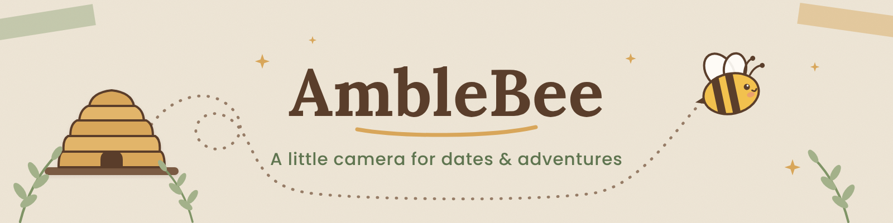

# 🐝 AmbleBee

**A little camera that takes you on dates and adventures.**

AmbleBee is a small camera that hands you a *mission*: a date or adventure idea to go out and do. Pick a coffee shop you've never tried, hike to a waterfall, get the strangest doughnut on the menu. You take photos along the way, and when you come home the camera docks into the **Hive**, a picture frame that keeps your photos and shows them as memories of where you've been.

Missions are gentle invitations, never tasks you can fail. No points, no streaks: just a nudge to get out the door together.

> AmbleBee is a personal project, built by hand and still in progress. 🛠️

---

## 🗺️ The missions

Every mission lives in **[amblebee-missions](../amblebee-missions)**, one small file per idea, grouped into **Amble packs**:

| Pack | What's inside |
|---|---|
| **Amble Anywhere** | Ideas that work wherever you are |
| **Amble Oregon** | Real places across Oregon, from Portland to the coast and the high desert |
| **Amble Washington** | Seattle, the Olympic Peninsula, the Gorge and beyond |
| **Amble Missouri** | St. Louis favorites |
| **Amble Louisiana** | New Orleans and the bayou |

Every place mission has coordinates, so the Hive can tell you how far away it is ("23 miles as the bee flies") before you say yes.

## 💡 Share a mission

Know a great date spot or a fun adventure? **[Submit it here](https://forms.gle/E6zAsDpkDqrWUHTt9)**. It takes about five minutes, and I read every one.

Comfortable with GitHub? Pull requests to [amblebee-missions](../amblebee-missions) are welcome too. Copy `_template.yaml`, fill it in, and the checker will tell you if anything's missing.

## 📦 Repositories

- **[amblebee-missions](../amblebee-missions)**: the mission catalog (public)
- **amblebee-hive**: camera firmware and the Hive frame (private for now)

## 📜 License

Mission content is shared under [CC BY-SA 4.0](https://creativecommons.org/licenses/by-sa/4.0/). Tools in the missions repo are MIT licensed.

---

Take bee on a mission. 🐝
